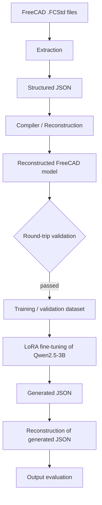

# CAD Copilot

An independent machine learning research prototype that explores whether a fine-tuned language model can generate structured CAD representations that can be reconstructed in FreeCAD.

I designed and built the full pipeline: FreeCAD extraction, a structured JSON representation, a reconstruction compiler, round-trip validation, dataset construction, LoRA fine-tuning of Qwen2.5-3B, and evaluation of the resulting model.

Repository: https://github.com/Hichri-Hassan/CAD

## Research Question

Can a small language model, fine-tuned on JSON descriptions of FreeCAD models, produce JSON that reconstructs into valid, functional CAD geometry?

## System Architecture



- **Extraction:** reads supported structures from `.FCStd` files.
- **JSON representation:** a structured intermediate format that serves as both the training target and the model output.
- **Compiler / reconstruction:** rebuilds CAD models in FreeCAD from JSON.
- **Round-trip validation (dataset stage):** FreeCAD → JSON → FreeCAD, used to decide which examples enter the dataset. It checks the data pipeline, not the model.
- **Evaluation (model stage):** a separate step that assesses JSON generated by the fine-tuned model.

## Dataset Construction

Recorded processing stages:

| Stage | Count |
|---|---|
| Source `.FCStd` files | 3,199 |
| Files parsed | 717 |
| Valid examples | 134 |
| Passed round-trip validation | 47 |
| Training examples | 40 |
| Validation examples | 7 |

The exact filtering criteria for each stage are not documented here. Dataset provenance is also not documented.

## Model and Fine-Tuning

The base model is Qwen2.5-3B, adapted with LoRA on the 40 training examples. The recorded validation loss was approximately 0.0054. Hyperparameters and hardware are not documented in this README.

## Evaluation, Findings and Limitations

Despite the low validation loss, generated outputs did not generalize reliably.   Quantitative generation metrics are not reported here.

Validation loss measures token-level prediction on held-out examples. It does not establish that generated JSON compiles into functional CAD, especially with a validation set of only 7 examples. Possible explanations, not established findings, include:

- Overfitting to a very small training set.
- Duplicate or near-duplicate examples across the training and validation splits.
- Data leakage between splits.

Other limitations: only a limited set of FreeCAD structures is supported, only a small fraction of the source files yielded usable examples (47 of 3,199), and the system is a research prototype, not a production tool.


## Proposed Future Experiments

These were not carried out:

- Check the splits for duplicates and leakage.
- Evaluate generated outputs by compile success and geometric comparison against reference models.
- Enlarge the dataset and broaden the supported CAD structures.
- Compare against baselines such as few-shot prompting of an unmodified model.

## Project Status

The project was discontinued in August 2026 and is experimental and inactive.
Validator → Compiler → FreeCAD → .FCStd / .STEP
```

This repository contains the architecture, specifications, parser, compiler, dataset pipeline, and future model training work.
