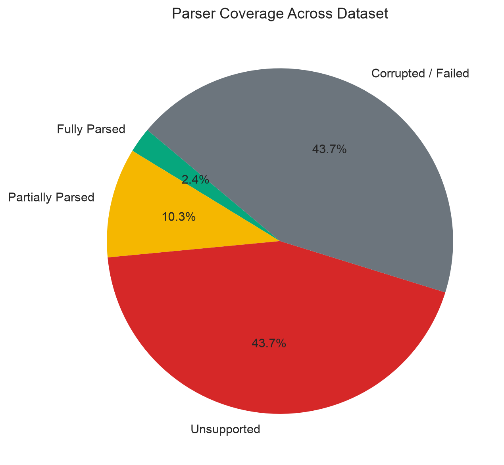
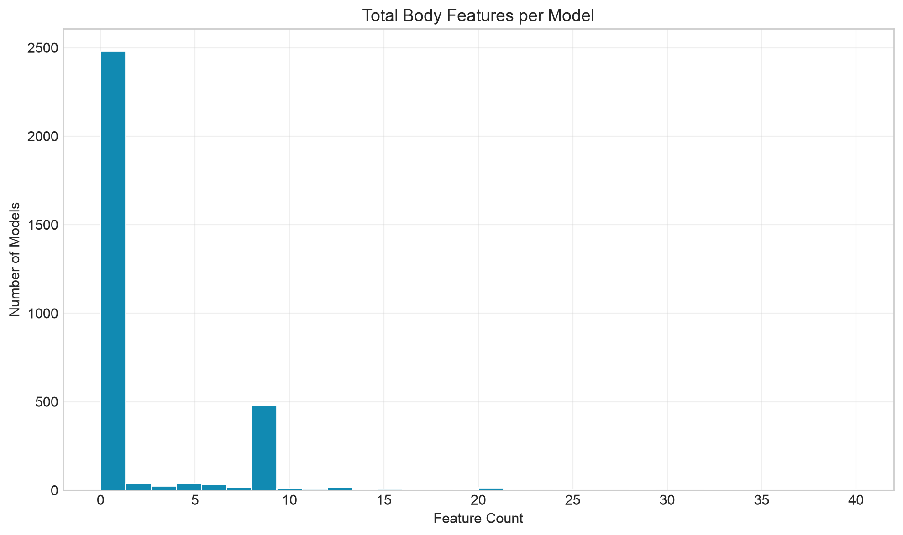
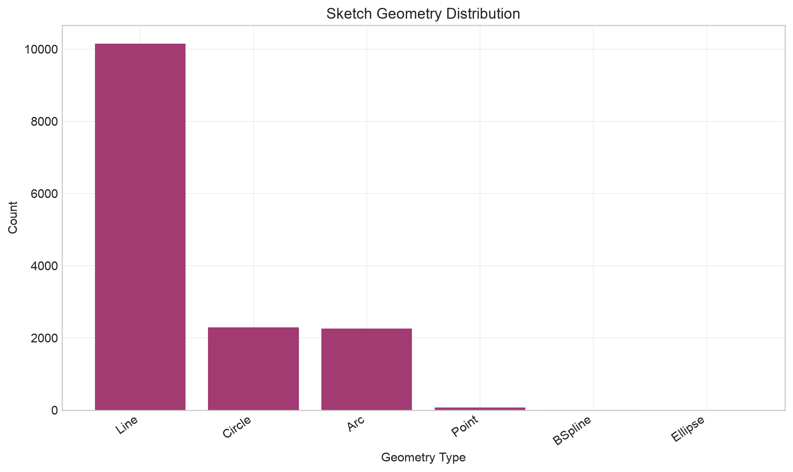
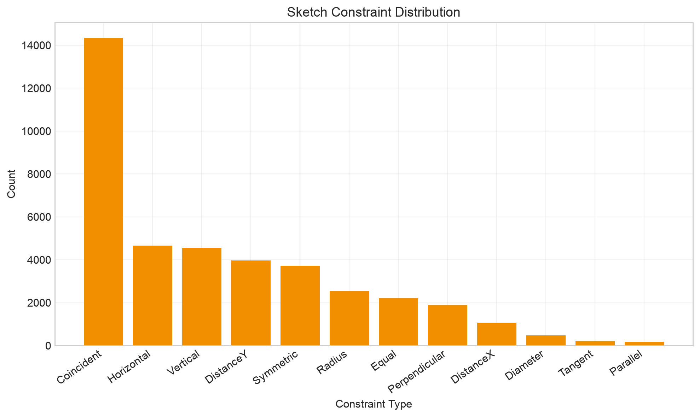
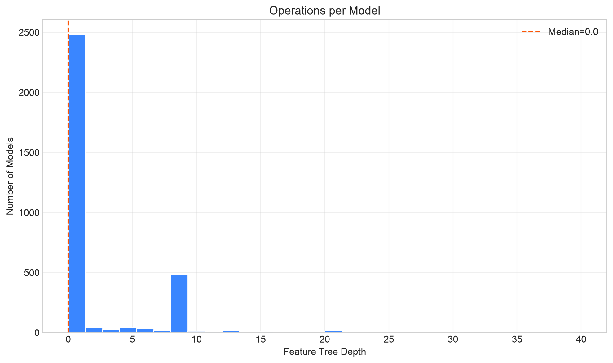
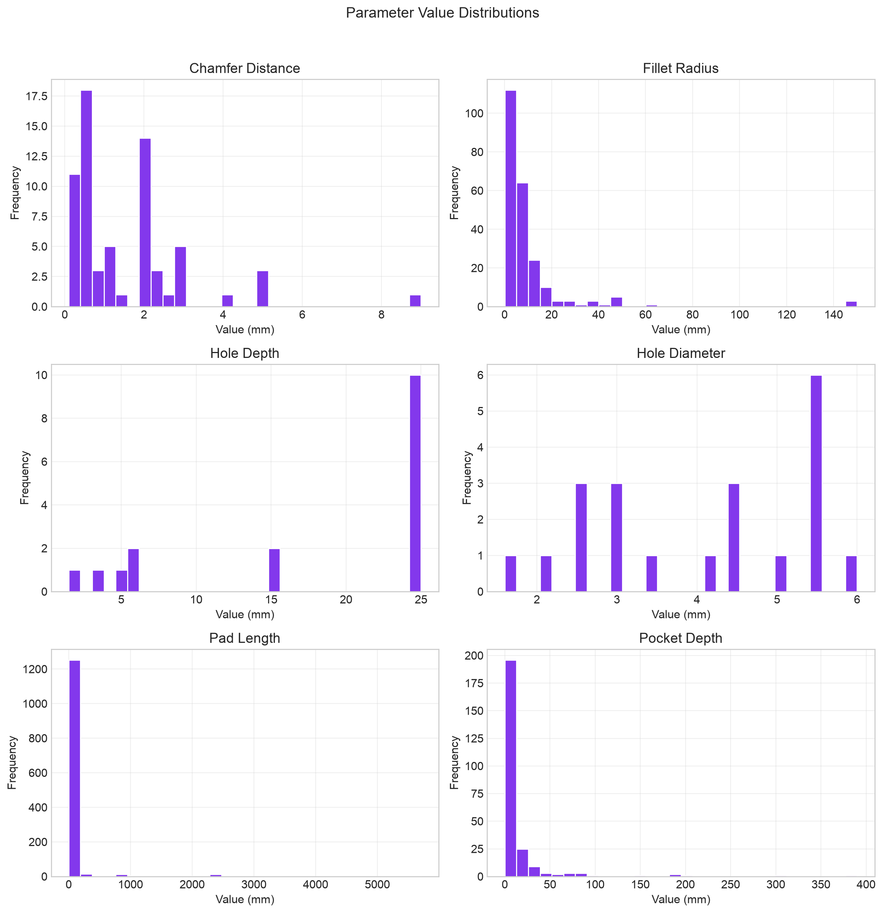
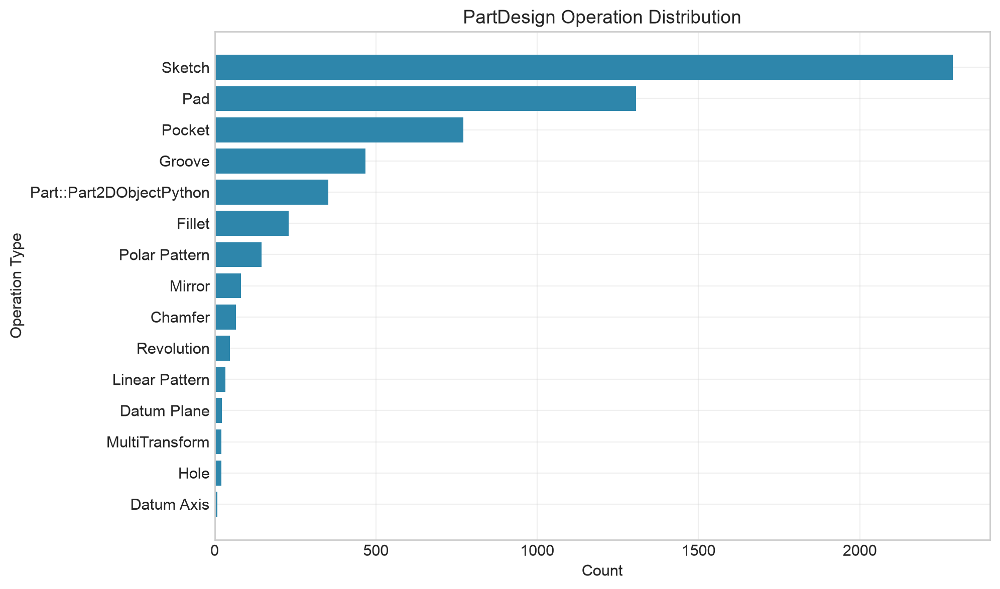

# Dataset Analysis Report

*Generated: 2026-06-30 19:48 UTC*

## 1. Dataset Summary

This report presents an automated analysis of the collected FreeCAD (`.FCStd`) dataset. The objective a is to quantify dataset composition, parser coverage, sketch complexity, and unsupported CAD functionality prior to model training or parser extension.

| Metric | Value |
|---|---:|
| Total models | 3,199 |
| Successfully parsed (≥1 operation) | 717 (22.4%) |
| Fully parsed (no unsupported features) | 134 (4.2%) |
| Partially parsed | 583 (18.2%) |
| Parser failures | 2,482 (77.6%) |
| Corrupted files | 0 |
| Unsupported models (no extractable body tree) | 2,482 |

### File Size Statistics

| Statistic | Bytes |
|---|---:|
| Mean | 283,018 |
| Median | 11,175 |
| Minimum | 3,099 |
| Maximum | 24,776,728 |

## 2. Parser Coverage

Each model was processed using the existing CAD Copilot parser in lenient mode. Raw PartDesign feature trees were additionally inspected to identify operation types outside the current parser scope.

- **Parser success rate:** 22.4% of models yielded at least one supported operation.
- **Full coverage rate:** 4.2% of models contain only parser-supported features.
- **Failure rate:** 77.6% of models could not be usefully parsed.

Detailed failure records are available in `parser_failures.csv`.

## 3. Operation Distribution

The dataset contains **5,896** PartDesign body features across all models.

| Operation | Count | Percentage |
|---|---:|---:|
| Sketch | 2,289 | 38.82% |
| Pad | 1,306 | 22.15% |
| Pocket | 771 | 13.08% |
| Groove | 467 | 7.92% |
| Part::Part2DObjectPython | 353 | 5.99% |
| Fillet | 230 | 3.90% |
| Polar Pattern | 145 | 2.46% |
| Mirror | 81 | 1.37% |
| Chamfer | 66 | 1.12% |
| Revolution | 47 | 0.80% |
| Linear Pattern | 34 | 0.58% |
| Datum Plane | 23 | 0.39% |
| MultiTransform | 21 | 0.36% |
| Hole | 21 | 0.36% |
| Datum Axis | 9 | 0.15% |

- Mean features per model: **1.84**
- Median features per model: **0.0**
- Maximum feature tree depth: **40**

## 4. Sketch Statistics

- Mean sketches per model: **0.72**
- Median sketches per model: **0.0**
- Total sketch entities: **14,787**
- Total sketch constraints: **40,093**
- Construction geometry entities: **497**

## 5. Geometry Statistics

| Geometry Type | Count | Percentage |
|---|---:|---:|
| Line | 10,150 | 68.64% |
| Circle | 2,295 | 15.52% |
| Arc | 2,259 | 15.28% |
| Point | 70 | 0.47% |
| BSpline | 12 | 0.08% |
| Ellipse | 1 | 0.01% |

## 6. Constraint Statistics

| Constraint Type | Count | Percentage |
|---|---:|---:|
| Coincident | 14,344 | 35.78% |
| Horizontal | 4,661 | 11.63% |
| Vertical | 4,544 | 11.33% |
| DistanceY | 3,971 | 9.90% |
| Symmetric | 3,723 | 9.29% |
| Radius | 2,535 | 6.32% |
| Equal | 2,211 | 5.51% |
| Perpendicular | 1,896 | 4.73% |
| DistanceX | 1,078 | 2.69% |
| Diameter | 481 | 1.20% |
| Tangent | 211 | 0.53% |
| Parallel | 176 | 0.44% |
| Block | 114 | 0.28% |
| Distance | 78 | 0.19% |
| Angle | 64 | 0.16% |

## 7. Complexity Statistics

| Metric | Value |
|---|---:|
| Average feature tree depth | 1.84 |
| Median feature tree depth | 0.0 |
| Maximum feature tree depth | 40 |
| 90th percentile feature tree depth | 8.0 |

## 8. Unsupported Operations

The following operation types appear in the dataset but are not fully supported by the current parser. These counts guide parser development prioritization.

| Operation | Occurrences |
|---|---:|
| Groove | 467 |
| Part::Part2DObjectPython | 353 |
| Polar Pattern | 145 |
| Mirror | 81 |
| Revolution | 47 |
| Linear Pattern | 34 |
| Datum Plane | 23 |
| MultiTransform | 21 |
| Datum Axis | 9 |
| Sweep | 6 |
| Shape Binder | 4 |
| AdditiveCylinder | 3 |
| FeatureBase | 3 |
| Thickness | 3 |
| Boolean | 3 |
| SubtractiveHelix | 3 |
| Loft | 2 |
| Part::SubShapeBinder | 2 |
| App::VarSet | 1 |
| AdditiveBox | 1 |

## 9. Feature Sequences and Co-occurrence

Transition patterns and common feature chains may inform future autoregressive CAD generation models.

### Most Common Operation Transitions

| Transition | Count |
|---|---:|
| Pad -> Sketch | 1,026 |
| Sketch -> Pad | 843 |
| Sketch -> Pocket | 647 |
| Sketch -> Groove | 466 |
| Groove -> Sketch | 353 |
| Part::Part2DObjectPython -> Pad | 349 |
| Pocket -> Sketch | 145 |
| Sketch -> Sketch | 127 |
| Polar Pattern -> Sketch | 126 |
| Sketch -> Polar Pattern | 110 |
| Groove -> Pad | 110 |
| Pad -> Pocket | 110 |
| Fillet -> Fillet | 93 |
| Pad -> Fillet | 66 |
| Fillet -> Sketch | 46 |

### Most Common Feature Chains

| Feature Chain | Count |
|---|---:|
| Pad -> Sketch | 1,026 |
| Sketch -> Pad | 843 |
| Sketch -> Pad -> Sketch | 674 |
| Sketch -> Pocket | 647 |
| Sketch -> Groove | 466 |
| Pad -> Sketch -> Pocket | 446 |
| Sketch -> Pad -> Sketch -> Pocket | 444 |
| Groove -> Sketch | 353 |
| Sketch -> Groove -> Sketch | 352 |
| Part::Part2DObjectPython -> Pad | 349 |
| Part::Part2DObjectPython -> Pad -> Sketch | 349 |
| Pad -> Sketch -> Groove | 349 |
| Part::Part2DObjectPython -> Pad -> Sketch -> Groove | 349 |
| Pad -> Sketch -> Groove -> Sketch | 349 |
| Groove -> Sketch -> Pad | 339 |

## 10. Parameter Statistics

Numeric parameter distributions for supported operations are exported in `parameter_statistics.csv` and visualized in `parameter_histograms.png`.

| Parameter | Samples |
|---|---:|
| chamfer_distance | 66 |
| fillet_radius | 230 |
| hole_depth | 21 |
| hole_diameter | 21 |
| pad_length | 1,306 |
| pocket_depth | 771 |

## 11. Potential Parser Improvements

Based on unsupported operation frequency, the highest-impact parser extensions are:

1. **Groove** — observed 467 times in the dataset.
2. **Part::Part2DObjectPython** — observed 353 times in the dataset.
3. **Polar Pattern** — observed 145 times in the dataset.
4. **Mirror** — observed 81 times in the dataset.
5. **Revolution** — observed 47 times in the dataset.
6. **Linear Pattern** — observed 34 times in the dataset.
7. **Datum Plane** — observed 23 times in the dataset.
8. **MultiTransform** — observed 21 times in the dataset.

## 12. Figures

## 13. Output Files

- `dataset_statistics.csv` — dataset-level summary metrics
- `model_statistics.csv` — per-model analysis records
- `operation_distribution.csv` — operation frequency table
- `geometry_distribution.csv` — sketch geometry frequency table
- `constraint_distribution.csv` — sketch constraint frequency table
- `parameter_statistics.csv` — extracted parameter summaries
- `unsupported_operations.csv` — unsupported operation counts
- `parser_failures.csv` — parser failure log
